# PERTINENCE GKE·KFP 아키텍처 설계 보고서

> 기준일: 2026-09-20
> 기준 범위: 현재 작업 트리의 `cloud/`, `pipelines/pertinence/`,
> `experiments/cifar10/configs/pipeline-run.yaml`
> 판독 원칙: 저장소 구현, production 실행 보고서, read-only cloud inventory와 Terraform
> zero-drift plan을 함께 근거로 사용한다.

## 1. 요약

현재 PERTINENCE의 가장 구체적이고 실행 가능한 클라우드 구성은 **GKE Standard 위의 OSS
Kubeflow Pipelines(KFP)에서 CIFAR-10 dispatcher를 CPU로 학습·평가하는 일회성 환경**이다.
데이터와 체크포인트는 GCS에서 읽고, 동일한 digest 고정 컨테이너 이미지로 7개 component를
실행하며, 결과는 다시 GCS pipeline root에 보존한다.

저장소에는 이 1차 학습 구성과, KServe 기반 온라인 추론·벤치마크까지 확장한 목표 구성이 함께
기술되어 있다. 두 구성을 구분하면 다음과 같다.

| 구분 | 현행 1차 학습 구성 | 확장 목표 구성 |
|---|---|---|
| 목적 | dispatcher 학습·Pareto 탐색·final 평가 | 승인 모델 serving 및 latency/throughput 측정 |
| 노드 풀 | `system-pool`, `pipeline-pool` | 앞의 2개 + `serving-pool`, `loadgen-pool` |
| 구현 수준 | KFP DAG 구현 및 production run 성공, Terraform adoption 완료 | 문서 설계 단계 |
| 저장소 | Raw GCS, Run GCS, Artifact Registry | 앞의 저장소 + Serving/Benchmark GCS |
| 외부 노출 | 없음, KFP API/UI는 port-forward | 없음, endpoint도 cluster 내부 전용 |
| 종료 정책 | 사용자 지시에 따라 cluster·KFP PVC 보존 | workload 제거 후 workload pool scale-to-zero |

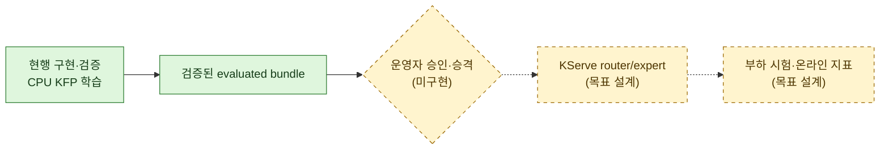

핵심 판정은 다음과 같다.

- KFP 7단계 DAG, immutable image digest 강제, GCS 입력 hash 검증, CPU/메모리 제한,
  `pipeline-pool` 배치 정책과 final holdout 격리는 코드와 테스트로 확인된다.
- GKE cluster와 node pool은 실제 cloud inventory로 확인했으며 Terraform 원격 state에 비파괴
  import했다. 마지막 `training-current` plan은 `No changes`다.
- KFP 설치본 전체는 vendoring하지 않는다. 배포된 KFP v2 호환 standalone backend에 저장소의
  launcher ConfigMap과 pipeline 구성을 적용하는 운영 방식이다.
- KServe runtime, router, promotion command와 serving/loadgen workload는 아직 구현되지 않았다.
  Node pool 자체는 Terraform 선택 프로필로 정의했지만 현재 cluster에는 활성화하지 않았다.
- `register-dispatchers`의 SQLite는 run별 산출물이며 중앙 Model Registry가 아니다.

## 2. 상태 판독과 신뢰 범위

### 2.1 상태 범례

| 표시 | 의미 | 판정 기준 |
|---|---|---|
| **구현** | 저장소에 실행 코드/manifest가 존재 | 테스트 또는 정적 검증 가능 |
| **운영 검증** | cloud resource와 실행 결과가 존재 | inventory, run artifact 또는 zero-drift plan으로 확인 |
| **목표 설계** | 향후 구조와 계약만 정의 | runtime/manifest가 아직 없음 |
| **외부 확인 필요** | 현재 증거 범위 밖 | 추가 cloud inventory 또는 실행 검증 필요 |

### 2.2 현재 상태 지도

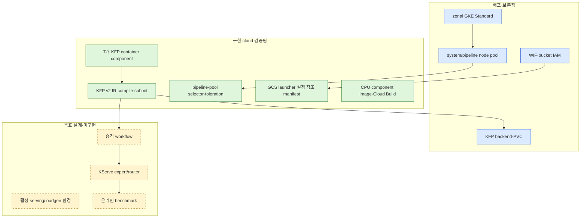

## 3. GCP·GKE 전체 구성

### 3.1 고정된 환경 값

| 항목 | 현재 선언값 | 상태 |
|---|---|---|
| Google Cloud project | `pertinence-509116` (`Pertinence`) | 운영 검증 |
| Project number | `423661327395` | 운영 검증 |
| Region / zone | `asia-northeast3` / `asia-northeast3-a` | 운영 검증 |
| GKE mode | Standard, zonal, VPC-native | 운영 검증 |
| Release channel | Regular | 운영 검증 |
| Workload Identity pool | `pertinence-509116.svc.id.goog` | 운영 검증 |
| KFP SDK | `kfp==2.17.0` | lock file로 확인 |
| Kubernetes extension | `kfp-kubernetes==2.17.0` | lock file로 확인 |
| Component architecture | `linux/amd64` | Cloud Build로 확인 |
| 실행 장치 | CPU only | IR 테스트로 확인 |
| 애플리케이션 외부 endpoint | 없음 | LoadBalancer·Ingress·forwarding rule 실사로 확인 |

### 3.2 시스템 컨텍스트

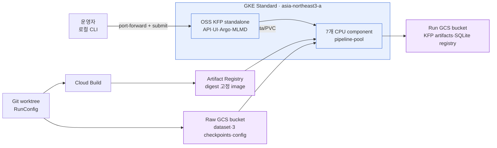

구성의 중요한 경계는 KFP metadata와 pipeline artifact의 저장 위치가 다르다는 점이다.
`defaultPipelineRoot`는 GCS Run bucket을 가리키지만, KFP API metadata, MySQL, ML Metadata와
SeaweedFS의 데이터를 자동으로 GCS로 이전하지 않는다. Cluster를 현재 보존 중이더라도 향후 명시적
종료 전에는 필요한 run metadata를 별도로 내보내야 한다.

### 3.3 노드 풀 설계

첫 dispatcher 학습 실행과 장기 목표의 크기가 다르다.

| Pool | Machine | 1차 실행 | 장기 목표 | Taint | 배치 대상 |
|---|---|---:|---:|---|---|
| `system-pool` | `e2-standard-4` | 1 고정 | 1 고정 | 없음 | KFP controller, API/UI, Argo, DB, importer/driver |
| `pipeline-pool` | `n2-standard-8` | 0–1 | 0–2 | `workload=pertinence-pipeline:NoSchedule` | 7개 container component |
| `serving-pool` | `n2-standard-8` | 없음 | 0–3 | `workload=pertinence-serving:NoSchedule` | KServe router/expert |
| `loadgen-pool` | `n2-standard-4` | 없음 | 0–1 | `workload=pertinence-loadgen:NoSchedule` | benchmark Job |

1차 실행의 `pipeline-pool` 상한 1은 문서에 기록된 프로젝트의 전역 12 vCPU quota를 맞추기 위한
값이다. `system-pool` 4 vCPU와 `pipeline-pool` 8 vCPU가 quota를 모두 사용한다. 장기 목표의 상한
2는 quota 증설 이후에만 유효하다. 두 pool의 boot disk는 1차 실행 기준 `pd-standard` 50 GiB다.

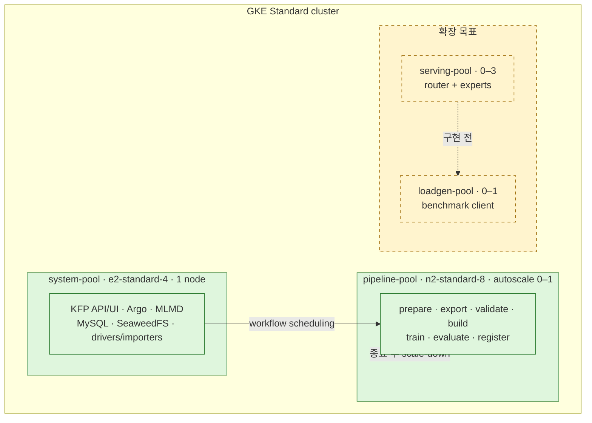

### 3.4 스케줄링 계약

7개 실제 연산 task에는 selector와 toleration을 함께 설정한다.

```yaml
nodeSelector:
  cloud.google.com/gke-nodepool: pipeline-pool
tolerations:
  - key: workload
    operator: Equal
    value: pertinence-pipeline
    effect: NoSchedule
```

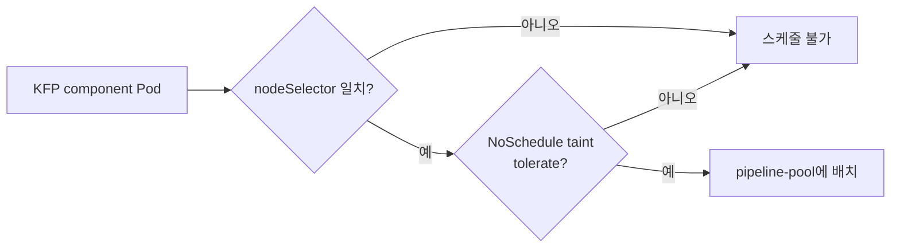

selector는 component가 다른 pool로 새는 것을 막고, toleration은 tainted `pipeline-pool`에 들어갈
권한을 준다. 다섯 importer는 GCS URI를 MLMD에 등록할 뿐 실제 byte를 처리하지 않으므로 system
pool 배치를 허용한다. KFP driver/root Pod와 cache-hit 보조 Pod도 system pool에서 실행될 수 있다.

## 4. KFP 플랫폼 구조

### 4.1 backend와 namespace

현행 backend는 `kubeflow` namespace의 single-user OSS KFP standalone 배포를 전제로 한다.

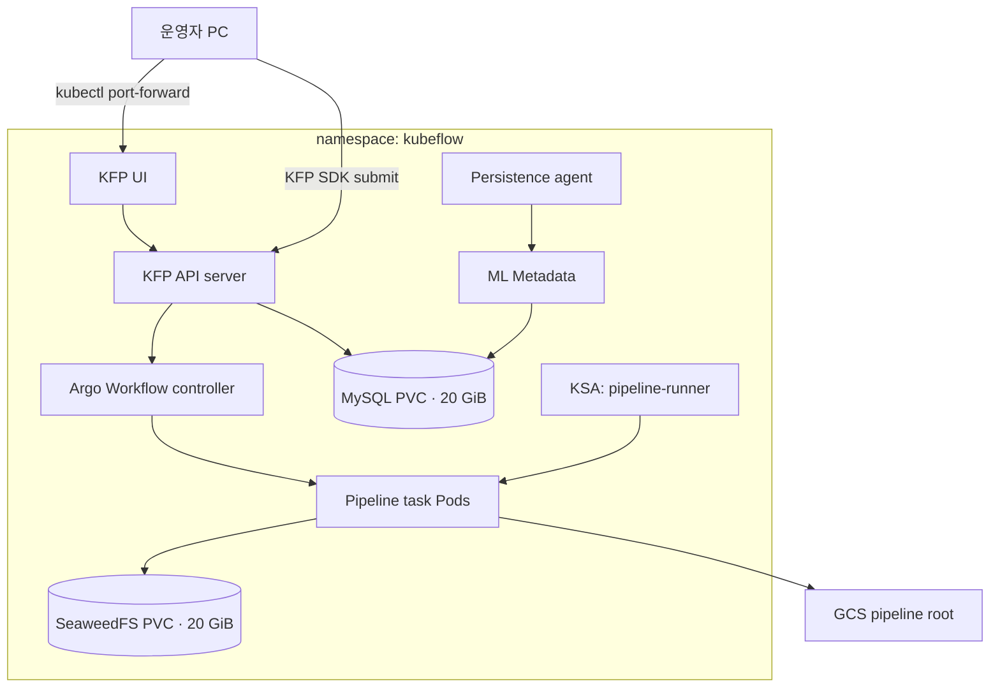

- public `LoadBalancer`나 ingress는 만들지 않고 `kubectl port-forward`만 사용한다.
- `pipeline-runner`는 KFP 배포판이 제공하는 RBAC와 함께 사용해야 한다. 저장소의
  `service-account.yaml`은 기대 이름과 namespace를 나타내는 참조이며, RoleBinding 없이 빈 SA만
  독립 적용해서는 안 된다.
- `kfp-launcher` ConfigMap은 `defaultPipelineRoot`와 `gs` provider의 environment credential 사용을
  설정한다.

### 4.2 compile과 제출 경로

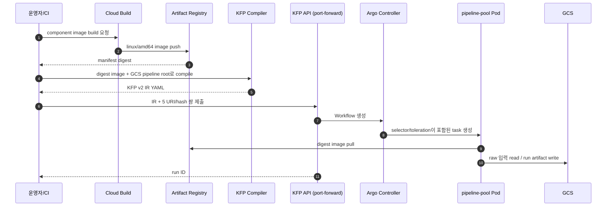

compile 단계는 cluster에 접속하지 않는다. 입력 image는
`<registry>/<name>@sha256:<64-hex>` 형식만 허용되어 mutable tag 사용을 차단한다.

## 5. KFP pipeline 설계

### 5.1 입력 계약

Pipeline 공개 입력은 다음 다섯 GCS 객체의 URI와 SHA-256, 총 10개 parameter다.

| 입력 | 역할 |
|---|---|
| CIFAR-10 archive URI/hash | dataset bundle 생성 |
| ShuffleNetV2 x0.5 checkpoint URI/hash | feature extractor·최저비용 expert |
| MobileNetV2 x0.5 checkpoint URI/hash | 중간비용 expert |
| ResNet56 checkpoint URI/hash | 고비용 expert |
| RunConfig URI/hash | split, 학습, NSGA-II 설정 |

RunConfig의 현행 핵심 값은 seed `20260824`, search/final `8,000/2,000`, dispatcher 20 epochs,
NSGA-II population/generation `50×50`이다. Expert 순서는 비용 오름차순 의미를 가지므로 자동
재정렬하지 않고 검증 실패로 처리한다.

### 5.2 실행 DAG

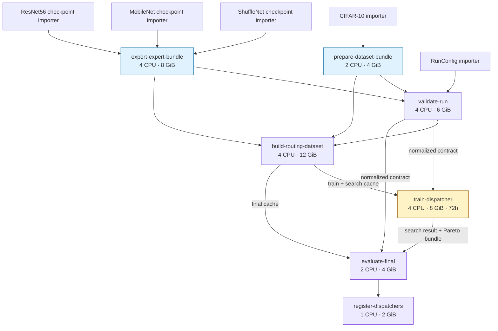

`prepare-dataset-bundle`과 `export-expert-bundle`은 서로 독립적으로 시작할 수 있다. 이후 validation,
routing cache 생성, dispatcher 탐색, final 평가, 등록이 순차적으로 이어진다.

### 5.3 component별 실행 정책

CPU와 memory는 request와 limit을 같은 값으로 설정한다. `OMP_NUM_THREADS`와
`MKL_NUM_THREADS`도 각 task의 CPU 값에 맞춰 oversubscription을 제한한다.

| Component | 주요 출력 | CPU / Memory | Cache 기본값 | Retry | 비고 |
|---|---|---:|---:|---:|---|
| `prepare-dataset-bundle` | DatasetBundle, hash | 2 / 4 GiB | off | 1 | CIFAR archive 검증·Parquet 변환 |
| `export-expert-bundle` | ExpertBundle, hash | 4 / 8 GiB | off | 1 | 3 expert를 ONNX로 export·검증 |
| `validate-run` | contract, split, report | 4 / 6 GiB | off | 1 | schema/hash/smoke inference 검증 |
| `build-routing-dataset` | train/search/final cache | 4 / 12 GiB | off | 1 | 3 expert 추론과 routing label 생성 |
| `train-dispatcher` | search result, Pareto bundle | 4 / 8 GiB | off | **0** | 72시간 deadline, 50×50 search |
| `evaluate-final` | final report, evaluated bundle | 2 / 4 GiB | off | 1 | 격리된 final cache로 사후 평가 |
| `register-dispatchers` | SQLite registry, report | 1 / 2 GiB | **항상 off** | 1 | run-scoped 등록 |

기본 compile과 submit은 cache를 끈다. 입력 URI/hash와 image digest가 완전히 같고 실패 복구가 필요한
경우에만 명시적으로 cache를 활성화한다. 긴 `train-dispatcher`는 자동 retry가 없으므로 중복된
대규모 탐색을 방지하지만, 세대 단위 resume가 없는 현재 구조에서는 node 장애 시 전체 탐색을 다시
수행해야 한다.

### 5.4 artifact와 데이터 계보

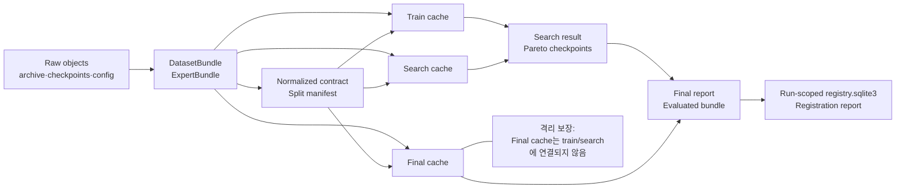

final holdout은 DAG 수준에서 `train-dispatcher`의 입력에 포함되지 않는다. IR 구조 테스트는 train
task가 `train_cache`, `search_cache`, `normalized_contract`만 받으며 이름이나 직렬화 내용에도
`final`이 없음을 검사한다. final cache는 `evaluate-final`에서만 Pareto 결과와 합쳐진다.

모든 주요 bundle은 manifest fingerprint와 개별 파일 SHA-256을 통해 내부 계보를 다시 검증한다.
KFP task cache, PERTINENCE 내부 fingerprint, 객체 byte SHA-256은 각각 실행 재사용, 의미적 동일성,
전송 무결성을 담당하는 서로 다른 방어선이다.

## 6. 인증·권한·네트워크 경계

### 6.1 Workload Identity와 IAM

JSON service-account key를 Pod에 mount하지 않고 GKE Workload Identity Federation을 사용한다.

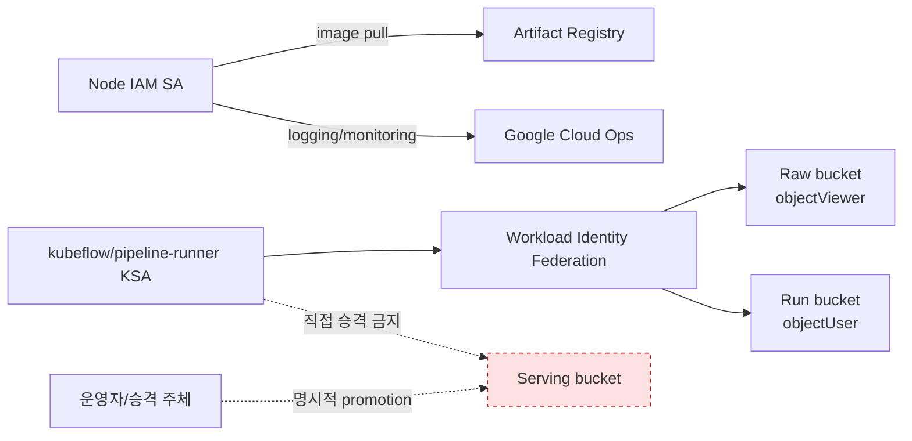

| Identity | 최소 권한 | 비고 |
|---|---|---|
| GKE node IAM SA | GKE node 기본 역할, Artifact Registry reader | application bucket 권한 배제 |
| `kubeflow/pipeline-runner` | Raw `objectViewer`, Run `objectUser` | KFP task 전용 |
| 운영자/향후 promotion job | Run read, Serving write | 평가와 배포 사이 승인 경계 |
| 향후 `serving-runner` | Serving read-only | 아직 미구현 |
| 향후 `benchmark-runner` | Benchmark write | 아직 미구현 |

KFP launcher가 외부 GCS artifact 처리 전에 bucket-level list를 요청할 수 있어, prefix 제한 IAM
condition을 사용할 때 bucket 자체에 대한 list와 허용 object prefix 조건을 함께 설계해야 한다.
이 condition은 문서화되어 있으나 적용 코드는 저장소에 없다.

### 6.2 네트워크

- KFP UI/API: public endpoint 없이 port-forward로만 접근한다.
- Pipeline Pod: GCS와 Artifact Registry outbound 접근이 필요하다.
- Private node를 선택할 경우 Cloud NAT 또는 Private Google Access 구성 검증이 필요하다.
- 확장 목표에서는 benchmark namespace → router, router → 승인 expert Service만 허용하는
  NetworkPolicy를 둔다.
- 현재 애플리케이션 LoadBalancer, Ingress, forwarding rule과 예약 address가 없음을 실사했다.
  NetworkPolicy와 private-node/NAT 전환은 여전히 확장 목표다.

## 7. 빌드·배포·운영 lifecycle

### 7.1 이미지 공급망

공용 component image는 Python 3.11 slim 기반이며 CPU PyTorch, ONNX Runtime과 pipeline runtime을
포함한다. Cloud Build는 `linux/amd64`로 빌드하고 지정 GCS bucket에 build log를 남긴다.

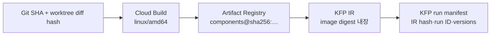

tag는 build 단계의 임시 식별자로 사용할 수 있지만, compile된 IR과 실행 manifest에는 manifest
digest를 기록해야 한다.

### 7.2 환경 lifecycle

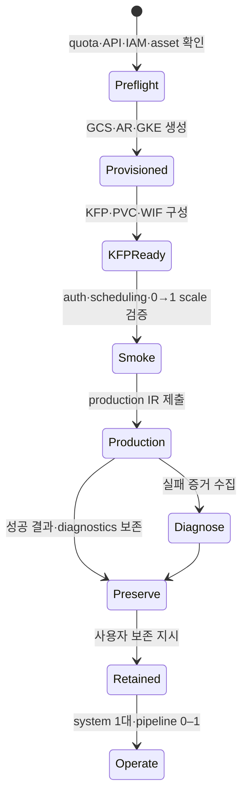

Production run은 성공했고 Raw/Run bucket, Artifact Registry digest와 diagnostics를 보존했다.
사용자 지시에 따라 cluster, KFP namespace, PVC/PV, Workload Identity binding과 두 node pool도
유지한다. Teardown은 완료 조건이 아니라 향후 별도 요청이 있을 때만 수행하는 운영 절차다.

### 7.3 완료 조건

Production 실행은 최소한 다음 gate를 모두 통과해야 한다.

1. KFP run과 일곱 component가 모두 성공한다.
2. 입력 SHA-256, contract, split/cache fingerprint가 모두 일치한다.
3. NSGA-II `50×50` 탐색과 모든 retained Pareto state 복원이 끝난다.
4. final metric이 유한하고 evaluated bundle이 생성된다.
5. registration report와 run-scoped SQLite artifact가 생성된다.
6. IR, run ID, Git/patch SHA, image digest, GKE/KFP version을 실행 manifest에 기록한다.
7. Artifact와 diagnostics를 GCS에서 다시 읽을 수 있음을 확인하고 보존 대상 cluster 상태를 기록한다.

## 8. 목표 serving 아키텍처

이 절은 현재 구현이 아니라 다음 단계의 목표 설계다.

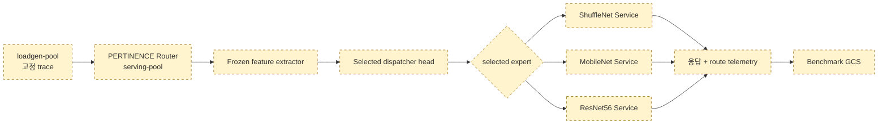

KServe는 Standard mode, 고정 replica, cluster 내부 ClusterIP 사용을 목표로 한다. feature extractor가
선택 expert와 같으면 이미 계산한 logits를 재사용하고, 다른 expert가 선택된 경우에만 내부
service를 호출한다. offline accuracy/MFLOPs와 online latency/throughput은 서로 다른 결과군으로
관리한다.

그러나 다음 항목은 아직 저장소에 구현되지 않았다.

- evaluated bundle을 Serving bucket으로 승격하는 명령과 승인 manifest
- router/expert runtime image와 `InferenceService`
- `serving-runner`, `benchmark-runner`와 bucket IAM
- serving/loadgen pool을 활성화한 별도 환경과 workload 배치
- NetworkPolicy, 부하 생성기, telemetry 수집·요약
- rollback과 dispatcher 전환 검증

따라서 현재 KFP 성공 결과를 곧바로 serving 가능 모델로 간주해서는 안 된다.

## 9. 위험과 개선 우선순위

| 우선순위 | 현재 위험 | 영향 | 권고 조치 |
|---:|---|---|---|
| P0 | `train-dispatcher` resume 없음 | node 장애 시 최대 72시간 재계산 | generation checkpoint와 deterministic resume 구현 |
| P1 | KFP addon·실험 IAM이 base IaC state 밖 | 수동 운영 drift | 별도 addon/IAM 계층과 read-only drift 검사 구현 |
| P1 | KFP metadata가 PVC에 잔류 | 향후 cluster 종료 시 lineage 손실 | 종료 전 metadata export를 자동 gate로 구성 |
| P1 | 실험 IAM condition이 base IaC 밖에서 적용됨 | state 밖 수동 drift | IAM을 코드화하고 negative permission test 추가 |
| P1 | ephemeral storage 제한 없음 | cache 생성 중 disk pressure/OOM 유사 실패 | task별 ephemeral request/limit 계측 후 지정 |
| P1 | 작은 smoke RunConfig가 없음 | production 설정으로 첫 검증 위험 | 별도 immutable smoke config 추가 |
| P2 | 1차/장기 node 상한이 문서별로 다름 | 용량 계획 혼선 | quota에 따른 profile을 명시적 config로 분리 |
| P2 | 중앙 Registry 부재 | run 간 승인/검색/rollback 어려움 | promotion manifest를 먼저 구현하고 필요 시 Registry 도입 |
| P2 | KServe 목표만 존재 | online 성능 주장 불가 | promotion → runtime → loadgen 순서로 단계적 구현 |

### 9.1 문서 drift

`cloud/dispatcher-training-run-plan.ko.md`는 실행 전 계획이므로 teardown과 일부 미구현 항목을
기록한다. 실제 실행에서는 selector/toleration을 구현했고 사용자의 보존 지시로 teardown을
`DEFERRED` 처리했다. 현행 상태의 정본은 실행 보고서와 IaC 구현 보고서다.

### 9.2 권장 다음 단계

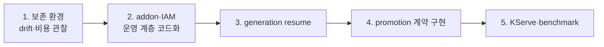

Cloud inventory, 1차 학습과 base GKE IaC adoption은 완료됐다. 다음 우선순위는 보존 환경의
drift·비용을 관찰하고 base state 밖의 addon/IAM 운영 계층과 generation resume를 코드화한 뒤,
명시적인 promotion 계약을 거쳐 KServe·benchmark로 확장하는 것이다.

## 10. 검증 결과

보고서 작성과 실행 완료 시점에 다음 검증을 수행했다.

| 검증 | 결과 |
|---|---|
| 전체 Python·pipeline 테스트 | **135 passed** |
| Terraform GKE module 테스트 | **11 passed** |
| Ruff | **All checks passed** |
| IR의 7개 component image digest 고정 | 테스트로 확인 |
| selector/toleration 적용 | 7개 executor 모두 테스트로 확인 |
| GPU resource 부재 | IR 테스트로 확인 |
| final cache의 train task 유입 방지 | IR 구조 테스트로 확인 |
| train timeout | `259200`초(72시간) 확인 |
| Production KFP run | **SUCCEEDED**, 2,500 evaluations, 233 registrations |
| Terraform dispatcher plan | **No changes** |
| GKE/KFP/PVC inventory | cluster RUNNING, 14 deployments Available, PVC 2개 Bound |

Cloud 실행에서 실제 component Pod의 pipeline-pool 배치, GCS 권한, autoscaling 0→1→0, KFP backend
호환성과 artifact 무결성을 확인했다. 상세 run ID와 fingerprint는 실행 보고서에 기록한다.

## 11. 근거 자료

- [Cloud 환경 목표와 구현 상태](README.md)
- [Dispatcher 학습 실행 계획](dispatcher-training-run-plan.ko.md)
- [Dispatcher 학습 실행 보고서](dispatcher-training-run-report.ko.md)
- [GKE IaC 구현 보고서](iac/IMPLEMENTATION_REPORT.ko.md)
- [KFP pipeline 정의](../pipelines/pertinence/pipeline.py)
- [KFP component 정의](../pipelines/pertinence/components.py)
- [KFP 제출 client](../pipelines/pertinence/submit.py)
- [GKE CPU 실행 가이드](../pipelines/pertinence/docs/gke-cpu.ko.md)
- [KFP launcher ConfigMap](../pipelines/pertinence/gke/kfp-launcher-configmap.yaml)
- [Pipeline runner 참조 ServiceAccount](../pipelines/pertinence/gke/service-account.yaml)
- [Cloud Build 정의](../pipelines/pertinence/cloudbuild.yaml)
- [CIFAR-10 production RunConfig](../experiments/cifar10/configs/pipeline-run.yaml)
- [KFP IR 구조 테스트](../pipelines/pertinence/tests/test_kfp_pipeline.py)
