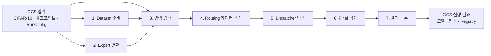
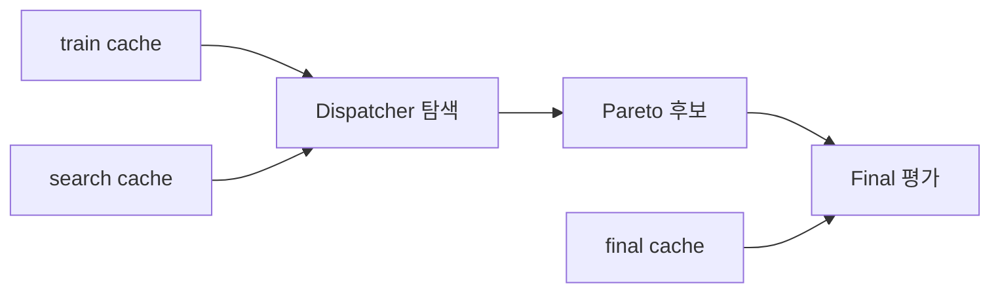
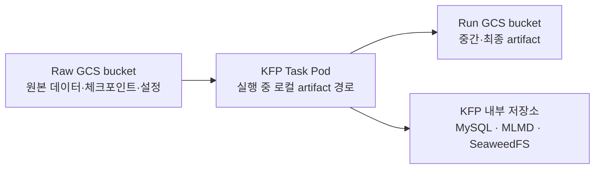

# PERTINENCE KFP 파이프라인 요약

> 기준일: 2026-09-20  
> 범위: GKE에서 실행하는 CIFAR-10 CPU 기반 Kubeflow Pipelines 구성

> 이 문서는 2026-09-20에 검증한 7단계 `pertinence-cifar10-cpu` legacy 실행의 기록이다.
> 현재 기본 compiler와 입력 계약은
> [pipeline package README](../pipelines/pertinence/README.md)를 따른다.

## 1. 전체 구조

이 파이프라인은 사전 학습된 세 개의 expert 모델과 CIFAR-10 데이터를 입력받아, 이미지별로
적절한 expert를 선택하는 dispatcher를 학습하고 평가한다. Expert 자체를 다시 학습하지는 않는다.

전체 실행은 다음 네 구간으로 나뉜다.

1. CIFAR-10과 expert checkpoint를 파이프라인용 bundle로 변환한다.
2. 입력을 검증하고 expert 예측과 feature를 포함한 routing 데이터를 생성한다.
3. 정확도와 연산 비용을 함께 고려하여 dispatcher 후보를 탐색한다.
4. 탐색에 사용하지 않은 final 데이터로 후보를 평가하고 실행 결과를 등록한다.



`prepare-dataset-bundle`과 `export-expert-bundle`은 서로 독립적이므로 병렬로 시작할 수 있다.
이후 validation, routing 데이터 생성, dispatcher 탐색, final 평가와 등록은 앞 단계의 결과를
순차적으로 전달받는다.

## 2. 최초 입력 데이터

파이프라인은 GCS에 저장된 다섯 개 객체를 입력으로 받는다. 각 객체의 URI와 SHA-256을 함께
전달하므로 공개 pipeline parameter는 총 10개다.

| 입력 | 역할 |
|---|---|
| CIFAR-10 archive | DatasetBundle 생성에 사용하는 원본 데이터 |
| ShuffleNetV2 x0.5 checkpoint | Feature extractor이자 최저비용 expert |
| MobileNetV2 x0.5 checkpoint | 중간비용 expert |
| ResNet56 checkpoint | 고비용 expert |
| RunConfig | Split, dispatcher 학습과 NSGA-II 설정 |

입력은 다음과 같은 경로에 저장한다.

```text
gs://<raw-bucket>/pertinence/raw/cifar-10-python.tar.gz
gs://<raw-bucket>/pertinence/raw/cifar10_shufflenetv2_x0_5.pt
gs://<raw-bucket>/pertinence/raw/cifar10_mobilenetv2_x0_5.pt
gs://<raw-bucket>/pertinence/raw/cifar10_resnet56.pt
gs://<raw-bucket>/pertinence/config/pipeline-run.yaml
```

URI만으로 파일이 바뀌지 않는다고 가정하지 않는다. 각 실행 단계에서 전달받은 SHA-256과 실제
파일 hash를 비교하며, 값이 다르면 실행을 중단한다.

현행 production RunConfig의 주요 값은 다음과 같다.

| 항목 | 값 |
|---|---:|
| Seed | `20260824` |
| Search split | 8,000 samples |
| Final split | 2,000 samples |
| Dispatcher 학습 | 20 epochs |
| NSGA-II population | 50 |
| NSGA-II generations | 50 |
| Routing expert 수 | 3 |

Expert 순서는 비용 오름차순 의미를 가진다. 설정 순서가 잘못된 경우 자동으로 재정렬하지 않고
검증 오류로 처리한다.

## 3. 단계별 역할과 입출력

| 실행 | 주요 입력 | 주요 출력 | 역할 |
|---|---|---|---|
| `prepare-dataset-bundle` | CIFAR-10 archive | DatasetBundle, bundle hash | 원본 데이터 검증 및 Parquet 변환 |
| `export-expert-bundle` | 세 checkpoint | ExpertBundle, bundle hash | Expert를 ONNX로 변환하고 결과 검증 |
| `validate-run` | 두 bundle, RunConfig | Contract, split manifest, report | Hash, schema, 모델 입출력과 설정 검증 |
| `build-routing-dataset` | Bundle, contract, split | Train/search/final cache | Expert 예측, feature와 routing label 생성 |
| `train-dispatcher` | Train/search cache | Search result, Pareto bundle | Dispatcher 학습과 NSGA-II 탐색 |
| `evaluate-final` | Final cache, Pareto 후보 | Final report, evaluated bundle | 격리된 데이터로 최종 성능 평가 |
| `register-dispatchers` | Evaluated bundle | SQLite registry, report | 평가된 dispatcher를 실행 단위로 등록 |

### 3.1 Dataset 준비

`prepare-dataset-bundle`은 CIFAR-10 archive의 hash를 검증하고 안정적인 `sample_id`를 가진
Parquet dataset으로 변환한다.

```text
dataset-bundle/
├── dataset.yaml
├── train/part-*.parquet
└── evaluation/part-*.parquet
```

`dataset.yaml`에는 class 정보, sample 수, shard 위치와 bundle fingerprint 등이 기록된다.

### 3.2 Expert 변환

`export-expert-bundle`은 PyTorch checkpoint를 CPU ONNX Runtime에서 실행 가능한 모델로 변환한다.

```text
expert-bundle/
├── experts.yaml
├── models/shufflenetv2_x0_5/model.onnx
├── models/mobilenetv2_x0_5/model.onnx
└── models/resnet56/model.onnx
```

세 expert는 분류 logits를 출력한다. Feature extractor로 사용하는 ShuffleNet은 dispatcher 입력에
필요한 classifier 직전 feature도 함께 출력한다. Export 후 ONNX 구조, 출력 shape와 PyTorch 대비
출력값을 검증한다.

### 3.3 실행 계약 검증

`validate-run`은 다음 항목을 fail-fast 방식으로 검사한다.

- Dataset, ExpertBundle, RunConfig의 SHA-256
- 클래스 수와 class index 의미
- Expert 순서와 비용 오름차순 여부
- Feature extractor와 fallback expert 존재 여부
- ONNX 모델의 입력·출력 shape와 유한값
- Search/final split 크기와 중복 여부
- Dispatcher와 NSGA-II 설정 범위

검증을 통과하면 이후 단계가 공유하는 normalized contract, split manifest와 validation report를
생성한다.

### 3.4 Routing 데이터 생성

`build-routing-dataset`은 모든 이미지에 대해 세 expert를 실행하여 다음 데이터를 미리 계산한다.

```text
이미지
  ├── ShuffleNet logits
  ├── MobileNet logits
  ├── ResNet56 logits
  ├── ShuffleNet feature
  └── cheapest-correct expert label
```

결과는 용도별로 분리한다.

| Cache | 사용 목적 |
|---|---|
| `train_cache` | Dispatcher 파라미터 학습 |
| `search_cache` | NSGA-II 후보 성능 비교 |
| `final_cache` | 탐색 완료 후 최종 사후 평가 |

Expert 추론 결과를 한 번만 생성해 두기 때문에 다수의 dispatcher 후보를 평가할 때 expert 추론을
매번 반복하지 않는다.

### 3.5 Dispatcher 학습과 탐색

Dispatcher는 ShuffleNet feature를 입력받아 세 expert 중 하나를 선택하는 작은 분류 모델이다.

```text
ShuffleNet feature
        │
        ▼
Linear dispatcher head
        │
        ▼
ShuffleNet / MobileNet / ResNet56 선택
```

NSGA-II는 다음 두 목적을 함께 최적화한다.

- 전체 시스템의 분류 정확도
- 선택된 expert의 평균 연산 비용

Production 설정은 population 50, generation 50으로 최대 2,500회의 후보 평가를 수행한다. 결과는
단일 최고 모델이 아니라 정확도와 비용 사이의 여러 Pareto dispatcher 후보다.

### 3.6 Final 평가

Final 데이터는 dispatcher 탐색에 사용하지 않는다.



`train-dispatcher`는 `train_cache`, `search_cache`, normalized contract만 입력받는다. `final_cache`는
Pareto 후보가 확정된 뒤 `evaluate-final`에서만 사용된다. 이 구조는 final holdout이 모델 선택에
유입되는 것을 DAG 수준에서 막는다.

### 3.7 결과 등록

최종 평가를 통과한 dispatcher와 metadata는 다음 artifact로 보존한다.

```text
registry-bundle/
├── registry.sqlite3
└── registration-report.json
```

이 SQLite Registry는 해당 KFP run의 결과를 보존하는 run-scoped artifact다. 여러 실행이 공유하는
중앙 Model Registry가 아니며, serving에 사용하려면 별도의 검토와 승격 과정이 필요하다.

## 4. 데이터 저장 위치



### 4.1 Raw GCS bucket

외부에서 준비한 원본 입력을 저장한다.

```text
gs://<raw-bucket>/pertinence/raw/
gs://<raw-bucket>/pertinence/config/
```

`kubeflow/pipeline-runner`는 이 bucket에 대해 읽기 권한을 가진다.

### 4.2 Task Pod 로컬 경로

실행 중 KFP launcher가 GCS artifact를 각 component 컨테이너의 artifact 경로로 전달한다.
Component는 GCS API를 직접 다루기보다 `Input[Artifact].path`와 `Output[Artifact].path`를 사용한다.
Pod 로컬 파일은 실행 중 작업 공간이며 영속 저장소로 간주하지 않는다.

### 4.3 Run GCS bucket

중간 및 최종 artifact는 다음 pipeline root 아래 저장된다.

```text
gs://<run-bucket>/pertinence/runs/
```

주요 저장 대상은 다음과 같다.

- DatasetBundle과 ExpertBundle
- Normalized contract와 split manifest
- Train/search/final cache
- Search result와 Pareto checkpoint
- Final report와 evaluated bundle
- SQLite registry와 registration report

`pipeline-runner`는 이 bucket에 artifact를 읽고 쓸 수 있다.

### 4.4 KFP 내부 저장소

KFP는 pipeline 정의, run/task 상태, artifact metadata와 lineage를 MySQL, ML Metadata, SeaweedFS 및
PVC에 별도로 관리한다. Run artifact가 GCS에 존재하더라도 KFP metadata까지 모두 GCS에 백업된
것은 아니다. 임시 GKE cluster를 제거하기 전에 필요한 metadata를 별도로 내보내야 한다.

## 5. 실행 환경과 정책

실제 계산을 수행하는 일곱 component는 `pipeline-pool`에 배치된다.

```yaml
nodeSelector:
  cloud.google.com/gke-nodepool: pipeline-pool
tolerations:
  - key: workload
    operator: Equal
    value: pertinence-pipeline
    effect: NoSchedule
```

KFP API, Argo controller, 데이터베이스, importer와 driver는 `system-pool`에서 실행한다.

| Component | CPU | Memory | Retry | 비고 |
|---|---:|---:|---:|---|
| Dataset 준비 | 2 | 4 GiB | 1 | Expert export와 병렬 가능 |
| Expert 변환 | 4 | 8 GiB | 1 | 세 모델 ONNX export |
| 실행 검증 | 4 | 6 GiB | 1 | CPU smoke inference 포함 |
| Routing 데이터 생성 | 4 | 12 GiB | 1 | 최대 memory 요청 |
| Dispatcher 탐색 | 4 | 8 GiB | 0 | 72시간 hard timeout |
| Final 평가 | 2 | 4 GiB | 1 | Final holdout 전용 |
| 결과 등록 | 1 | 2 GiB | 1 | Cache 항상 비활성화 |

Task cache는 기본적으로 꺼져 있다. 입력 URI, SHA-256과 image digest가 동일한 실패 복구 실행에서만
명시적으로 활성화한다. 가장 오래 걸리는 `train-dispatcher`는 중복 탐색을 피하기 위해 자동 retry를
사용하지 않는다.

## 6. 결과 해석 시 주의점

- Pipeline 결과는 dispatcher의 offline 정확도와 연산량 평가다.
- KServe 배포, 실제 latency, throughput과 autoscaling 측정은 현재 pipeline 범위에 포함되지 않는다.
- `register-dispatchers` 결과는 중앙 Registry나 운영 배포 승인을 의미하지 않는다.
- GCS artifact와 KFP metadata는 저장 위치와 보존 방법이 서로 다르다.
- Pipeline code와 IR은 로컬 테스트로 검증됐지만 실제 GKE scheduling, IAM과 autoscaling은 cloud
  smoke run으로 별도 확인해야 한다.

## 7. 관련 문서

- [GKE·KFP 전체 아키텍처 보고서](docs/architecture.ko.md)
- [Cloud 환경 설계](README.md)
- [GKE CPU 실행 가이드](docs/runbook.ko.md)
- [KFP pipeline 정의](../pipelines/pertinence/pipeline.py)
- [KFP component 정의](../pipelines/pertinence/components.py)
- [Production RunConfig](../experiments/cifar10/configs/pipeline-run.yaml)
