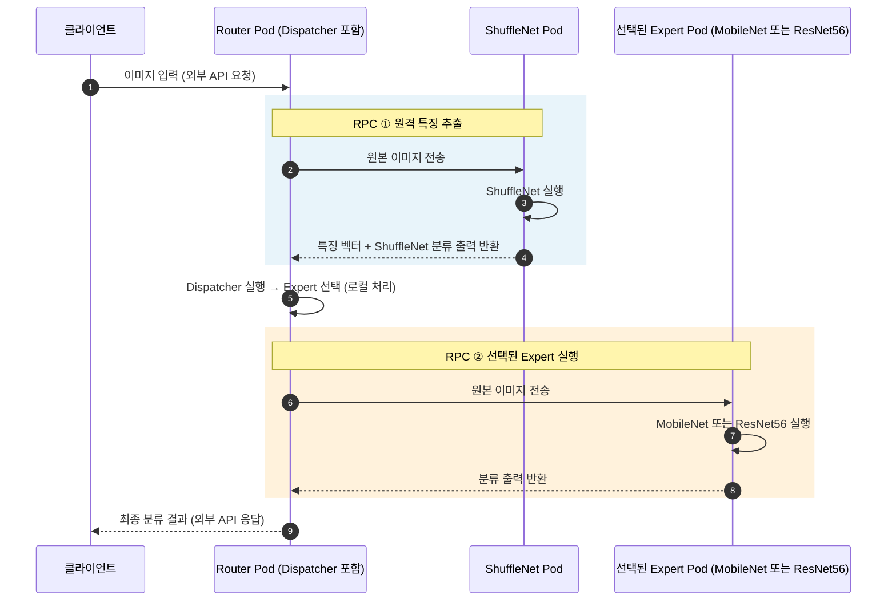

# Distributed 구조의 RPC 구간

## 핵심 설명

- **RPC ①:** Router가 별도 ShuffleNet Pod에 이미지를 보내 특징과 분류 출력을 받습니다.
- **로컬 처리:** Dispatcher는 Router 안에서 특징을 받아 Expert를 선택합니다. 별도 RPC는 없습니다.
- **RPC ②:** Router가 선택된 MobileNet 또는 ResNet56 Pod에 **원본 이미지**를 보내 분류 출력을 받습니다. 특징 벡터를 Expert로 보내는 구조가 아닙니다.
- RPC 한 번은 요청과 응답을 묶어 센 것입니다. 따라서 두 구간은 내부 RPC 총 2회에 해당합니다. 클라이언트와 Router 사이의 외부 API 요청·응답은 이 횟수에서 제외합니다.
- ShuffleNet이 선택되면 첫 번째 RPC에서 받은 분류 출력을 재사용하므로 두 번째 RPC는 생략됩니다. 발표 실험에서는 ShuffleNet 선택 비율이 0%였으므로 모든 요청에서 내부 RPC가 2회 발생했습니다.

## 발표용 설명

“Distributed에서는 Router가 먼저 ShuffleNet 서버를 호출해 특징을 받아옵니다. 이것이 첫 번째 RPC입니다. 이후 Router 내부의 Dispatcher가 Expert를 선택하고, 선택된 Expert 서버에 원본 이미지를 보내 분류 결과를 받습니다. 이것이 두 번째 RPC입니다. 따라서 이번 실험에서는 요청 한 건마다 내부 서비스 호출이 두 번 발생했습니다.”

## 코드 근거

`src/pertinence/serving/runtime.py`의 `DynamicRouter.predict`에서 특징 추출용 `call(self.extractor_id, include_features=True)`을 수행한 뒤, Dispatcher를 로컬에서 실행합니다. 선택된 Expert가 특징 추출 모델과 다르면 `call(expert_id)`를 추가로 수행하며, 두 호출 모두 원본 `image`를 사용합니다.
