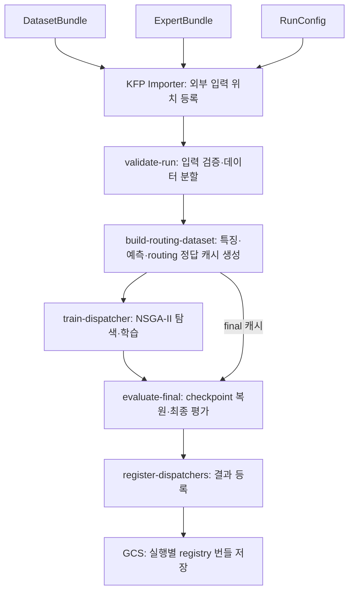

## 1. 개발환경

- GKE 기반으로 KFP 학습 자동화 및 KServe 온라인 추론 환경 구축
- GPU 없이 CPU 환경에서 실험 수행
- 시스템·학습·추론·부하 생성 노드를 분리하여 자원 경쟁 완화

| 노드 풀 | 머신 | 역할 |
|---|---|---|
| 시스템 | e2-standard-4 | KFP 및 클러스터 운영 |
| 학습 | n2-standard-8 | 캐시 생성·학습·평가 |
| 추론 | n2-standard-8 | KServe 모델 서빙 |
| 부하 생성 | n2-standard-4 | 요청 전송·응답시간 측정 |

**추천 그림:** GKE 안에 학습 환경과 서빙 환경을 구분한 전체 구성도

## 2. 동적 모델 선택 및 학습 자동화

- CIFAR-10 이미지 분류에 ShuffleNetV2 x0.5·MobileNetV2 x0.5·ResNet56 사용
- 이미지 특징을 dispatcher에 전달하고, 선택된 expert의 분류 결과를 출력
- Expert(CNN 모델)는 고정하고 dispatcher만 학습
- NSGA-II로 정확도와 평균 연산량을 고려한 Pareto 후보 탐색

**추론 흐름**

`입력 이미지 → 특징 추출 → Dispatcher → 선택된 Expert → 분류 결과`

**KFP 파이프라인 전체 구조**

- 입력: DatasetBundle(이미지·정답), ExpertBundle(ONNX 모델·모델 정보), RunConfig(데이터 분할·학습·탐색 조건)
- 각 입력의 GCS URI와 SHA-256을 전달하고, Importer로 외부 입력의 위치를 KFP 메타데이터에 등록
- 5개 계산 컴포넌트는 Kubernetes의 개별 컨테이너 Pod로 실행하며, 학습 산출물과 평가 결과는 GCS에 저장

**각 컴포넌트의 역할**

| 컴포넌트 | 역할 |
|---|---|
| `validate-run` | 입력 검증 및 데이터 분할 |
| `build-routing-dataset` | 특징·예측·routing 정답 캐시 생성 |
| `train-dispatcher` | Dispatcher 학습 및 Pareto 후보 탐색 |
| `evaluate-final` | 최종 데이터에서 후보 성능 평가 |
| `register-dispatchers` | 모델 정보 및 평가 결과 등록 |

**추천 그림:** 위쪽에 간단한 추론 흐름, 아래쪽에 KFP 전체 구조와 컴포넌트 역할 표 배치

**핵심 메시지:** 입력·산출물 해시 검증, 고정 seed, 탐색·최종 평가 데이터 분리로 재현성을 확보했습니다.

## 3. 초기 실험 — Direct와 Distributed 비교

- Direct: ResNet56 직접 실행
- Distributed: Router → 원격 특징 추출 → dispatcher → 원격 expert
- Warm-up 200건 이후 동일 이미지 2,000건 평가
- 5 RPS, 동시 요청 수 1, 재시도 없음

| 지표 | Direct | Distributed |
|---|---:|---:|
| 정확도 | 94.60% | 94.65% |
| 평균 연산량 | 251.50 MFLOPs | 210.73 MFLOPs |
| 평균 지연시간 | 10.379ms | 25.845ms |
| p95 지연시간 | 12.646ms | 30.379ms |

**추천 그림:** 두 구조의 요청 경로와 평균·p95 지연시간 비교 그래프

**핵심 메시지:** 연산량은 **16.2% 감소**했지만 응답시간은 증가했습니다. 정확도 차이 0.05%p는 정답 1건에 해당합니다.

## 4. 병목 분석 — 모델 계산보다 큰 데이터 변환 비용

- 구간별 계측을 추가한 별도 실행에서 평균 응답시간 **29.853ms** 측정
- 내부 직렬화·역직렬화 CPU 시간: **9.787ms/요청**
- 모델 실행 CPU 시간: **3.939ms/요청**
- 요청마다 내부 HTTP 호출 2회, 새 연결 2회 발생
- 내부 요청·응답 본문 크기 합계 약 141KB

**추천 그림:** 데이터 변환과 모델 실행의 CPU 시간 비교 막대그래프

**핵심 메시지:** JSON 데이터 변환에 모델 실행의 **약 2.5배 CPU 시간**을 사용했습니다.

**하단 주석:** 앞선 실험과 별도 실행입니다.

## 5. 통신 최적화 — Binary·Keep-alive·Fused 비교

- Binary: FP32 값을 바이트 배열로 전달하여 데이터 변환 비용과 전송량 감소
- Keep-alive: 내부 연결을 재사용하여 반복 연결 생성 감소
- Fused: 모든 모델을 동일 프로세스에 배치하여 내부 RPC 제거

| 조건 | 평균 지연시간 | 기준 대비 감소 |
|---|---:|---:|
| Distributed 기준 | 29.853ms | — |
| Binary | 20.271ms | 32.1% |
| Keep-alive | 25.806ms | 13.6% |
| Binary + Keep-alive | 16.743ms | 43.9% |
| Fused | 12.692ms | 57.5% |

**추천 그림:** 조건별 평균 지연시간 가로 막대그래프

**핵심 메시지:** 데이터 변환과 연결 처리를 줄이면 지연시간이 개선되며, 내부 RPC를 제거한 Fused가 가장 빨랐습니다.

## 6. Hybrid — 공통 경로를 통합하고 Expert의 독립 확장 유지

**전환 설명:** Fused는 가장 빨랐지만, 특정 expert의 요청이 늘어도 전체 Pod를 함께 복제해야 합니다. 따라서 expert별 독립 확장을 유지하면서 통신 비용을 줄이는 Hybrid 구조를 고안했습니다.

- 모든 요청이 거치는 특징 추출 모델과 dispatcher를 Router에 통합
- MobileNet·ResNet56은 별도 Pod로 유지
- 원격 expert 호출에는 Binary와 Keep-alive 적용
- 이번 선택 분포에서 요청당 내부 RPC를 2회에서 1회로 축소

| 항목 | Distributed¹ | Hybrid | Fused |
|---|---:|---:|---:|
| Pod 수 | 4 | 3 | 1 |
| 요청당 내부 RPC | 2회 | 1회 | 0회 |
| 평균 지연시간 | 16.743ms | 14.662ms | 12.692ms |
| Expert 독립 확장 | 가능 | 가능 | 전체 Pod 단위 |

¹ Binary + Keep-alive 적용.

**추천 그림:** Router 내부의 `특징 추출 + Dispatcher`와 외부 expert 두 개를 연결한 구조도

**핵심 메시지:** Hybrid는 개선된 Distributed보다 평균 지연을 **12.4% 줄이면서** expert별 독립 확장 구조를 유지했습니다.

**하단 주석:** 실제 부하 증가 시 처리량과 자동 확장 효과는 추가 검증이 필요합니다.

## 7. 결과 — Hybrid도 Direct보다 빠르지 않았음

- Distributed의 통신 비용을 줄인 Hybrid도 Direct보다 낮은 지연시간을 달성하지 못함

| 지표 | Direct | Hybrid |
|---|---:|---:|
| 평균 지연시간 | 10.379ms | 14.662ms |
| p95 지연시간 | 12.646ms | 17.092ms |

**추천 그림:** Direct와 Hybrid의 평균·p95 지연시간 비교 막대그래프

**핵심 메시지:** 분산 구조의 통신 비용을 개선했지만, 이번 조건에서는 ResNet56 단일 서빙보다 빠르지 않았습니다.

**다음 페이지 연결:** 모델 선택이 지연시간 개선으로 이어지지 않은 원인을 선택 분포와 실제 실행시간으로 분석합니다.

**하단 주석:** Direct와 Hybrid 수치는 각각 초기 비교와 최적화 실험에서 얻은 값이며, 할당 자원도 다릅니다.

## 8. 결과 분석 — 선택 분포와 실제 실행 비용의 영향

- 선택 비율: MobileNet **32%**, ResNet56 **68%**, ShuffleNet **0%**
- 모든 요청에서 특징 추출·dispatcher 실행 이후 추가 expert 계산이 필요하고, Hybrid에는 원격 expert 호출 1회도 남아 있음
- 특히 전체 요청의 **68%는 ResNet56까지 실행**하므로 계산 절감 기회가 제한적
- FLOPs 감소가 실제 실행시간 감소에 비례하지 않아, 저비용 expert 선택으로 얻는 시간 절감도 제한적

| 모델 | 연산량 | 평균 모델 실행시간 |
|---|---:|---:|
| ShuffleNet | 21.80 MFLOPs | 1.323ms |
| MobileNet | 55.94 MFLOPs | 1.464ms |
| ResNet56 | 251.50 MFLOPs | 2.939ms |

**추천 그림:** Expert 선택 비율과 모델별 실행시간 비교 그래프

**핵심 메시지:** ResNet56은 ShuffleNet보다 연산량이 **약 11.54배** 많지만 실행시간은 **약 2.22배**였습니다. 이번 조건에서는 모델 선택에 따른 계산 절감이 특징 추출·dispatcher·남은 통신 비용을 상쇄하지 못한 것으로 해석됩니다.

**다음 페이지 연결:** 따라서 통신 최적화와 함께, 실제 실행 비용을 반영한 dispatcher 학습과 선택 분포 개선을 검토해야 합니다.

**하단 주석:** 모델별 실행시간 표는 별도 직접 호출 실험 결과로, 특정 CPU·런타임의 저부하 조건에 한정되며 내부 검증을 포함합니다.

## 9. 향후 과제 — 실제 비용을 반영한 모델 선택

| 분석에서 확인한 한계 | 향후 과제 |
|---|---|
| FLOPs와 실제 실행시간의 차이 | 측정 실행시간·CPU 사용량을 dispatcher 학습 비용에 반영 |
| ResNet56 선택 비율 68% | 다른 데이터셋·expert 조합·학습 설정에서 선택 분포와 성능 비교 |
| 모든 요청에서 추가 expert 실행 | 특징 추출 모델의 예측만으로 종료하는 비율과 정확도의 관계 확인 |
| 저부하 지연시간 중심 평가 | 동일 정확도에서 지연시간·처리량·자원 사용량 및 자동 확장 효과 검증 |

**검증 방향:** 특징 추출 모델에서 종료하는 요청이 늘면 추가 계산과 Hybrid의 원격 호출을 함께 줄일 수 있지만, 정확도 저하 가능성과 기본 처리 비용도 함께 평가해야 합니다.

**마무리 문구:**

**“동적 모델 선택의 효과는 이론적 연산량뿐 아니라 실제 서비스 전체 비용으로 평가해야 한다.”**
